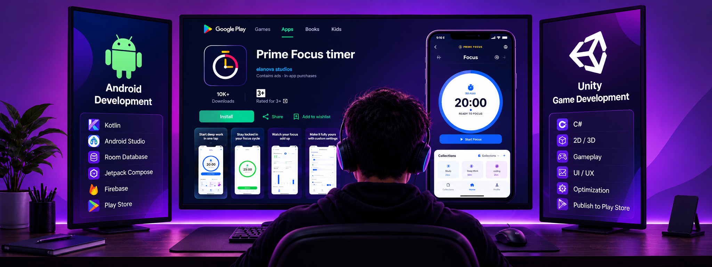

 

# ETLA NAVEEN KUMAR

**Android Developer**   ·   **Unity Game Developer**   ·   **Full Stack Developer**

Building mobile applications, interactive games, and modern web experiences.

 

&nbsp;

&nbsp;

  

 

DESIGN   →   DEVELOP   →   TEST   →   IMPROVE

---
